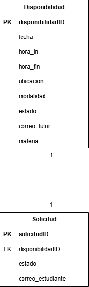
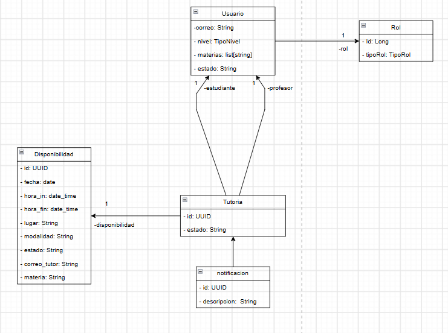

# DOSW_ParcialT2_SergioVega & SantiagoIbañez

Integrantes: Santiago Ibañez & Sergio Vega

https://github.com/DOSW-2026-2/PT2-DOSW-G03

### Diagrama entidad-relación (ER)

Teniendo en cuenta que los sistemas externos guardan gran parte de la informacion, ya sea de los estudiantes, profesores, TutoECI solo guardara las disponibilidades y las solicitudes como se aclara en el enunciado.

Enlace: [Diagrama ER](https://drive.google.com/file/d/1yjvgO4eR-czK0WHUD87W2PtYk5vn8DFs/view?usp=sharing)

### Diagrama de clases 

Enlace: [Diagrama de clases](https://drive.google.com/file/d/1jrAjBPYwv7qg4wJVLqQxxu1wb4r0zIo8/view?usp=sharing)
